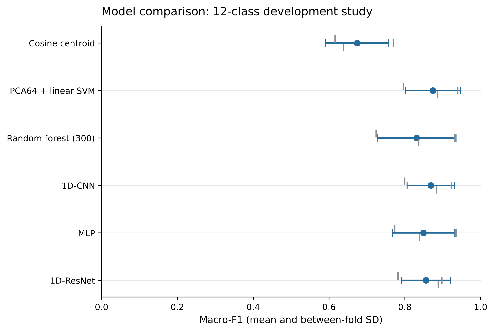
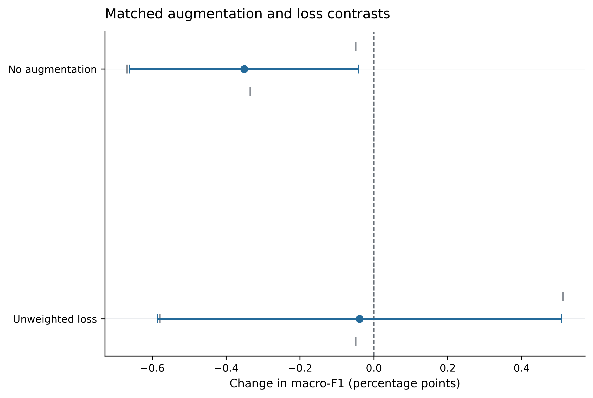
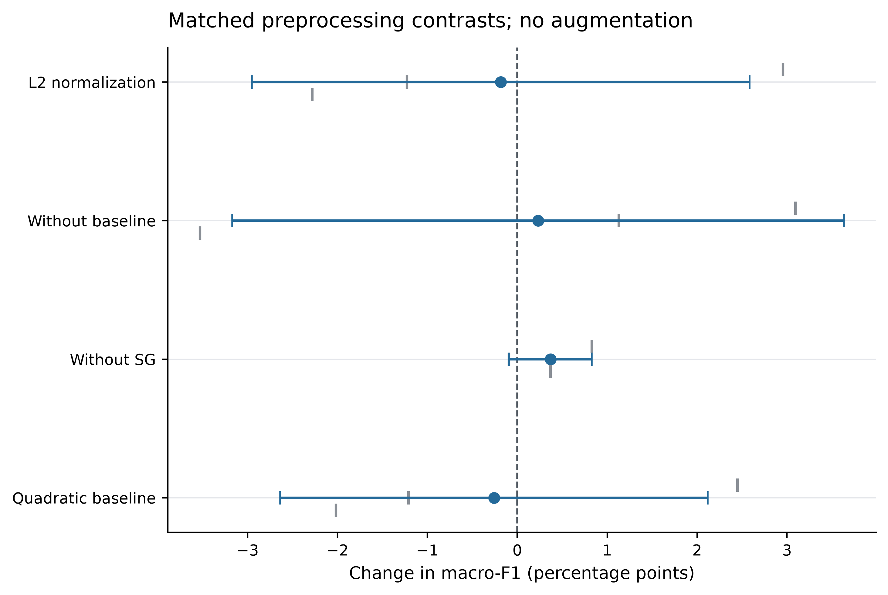
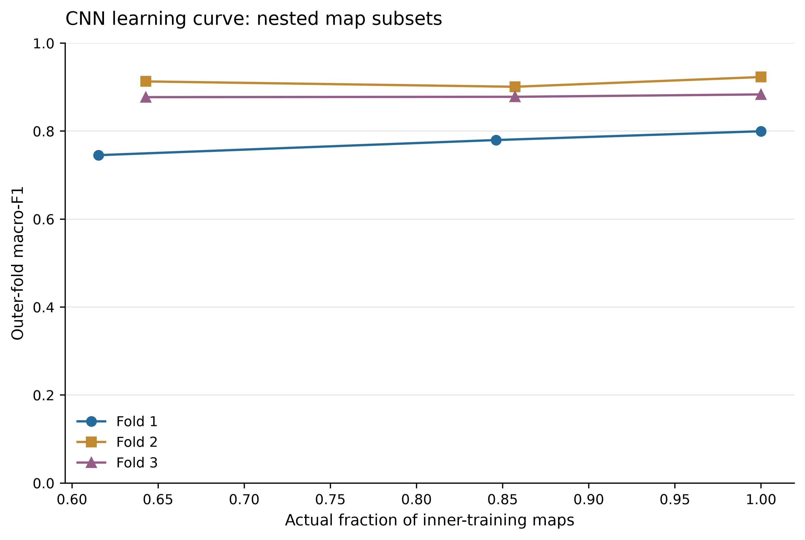
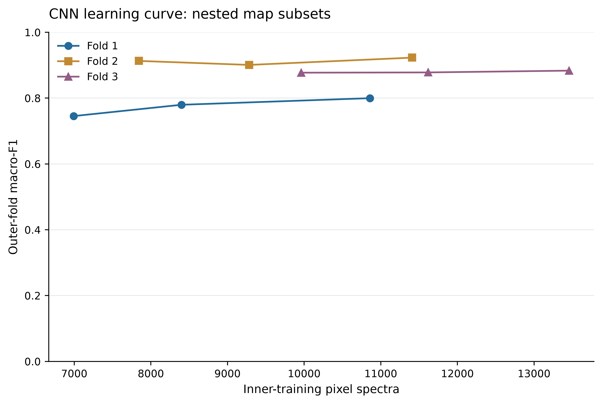
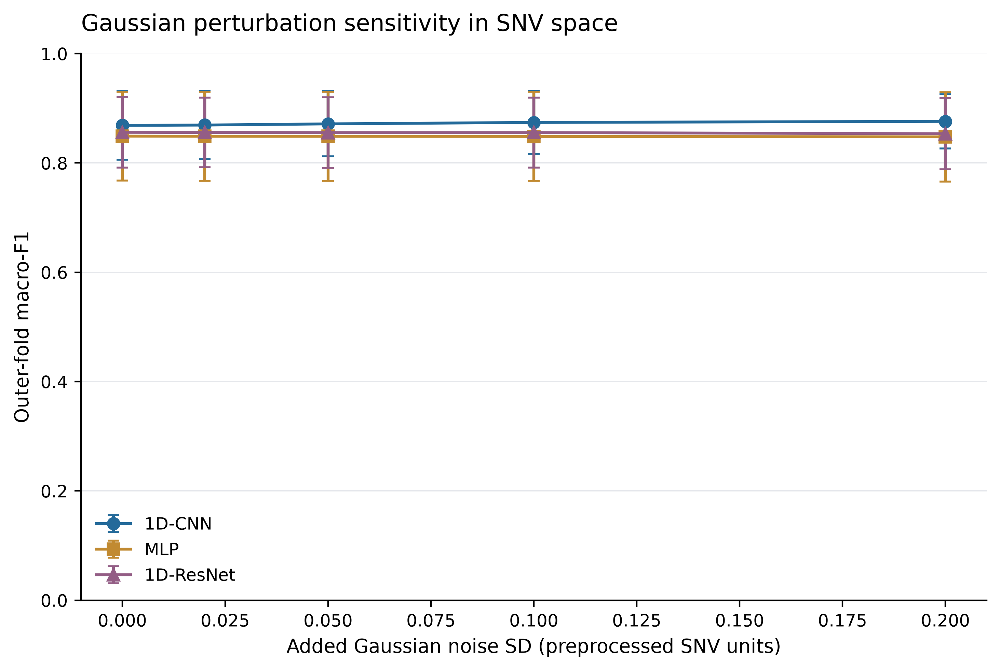
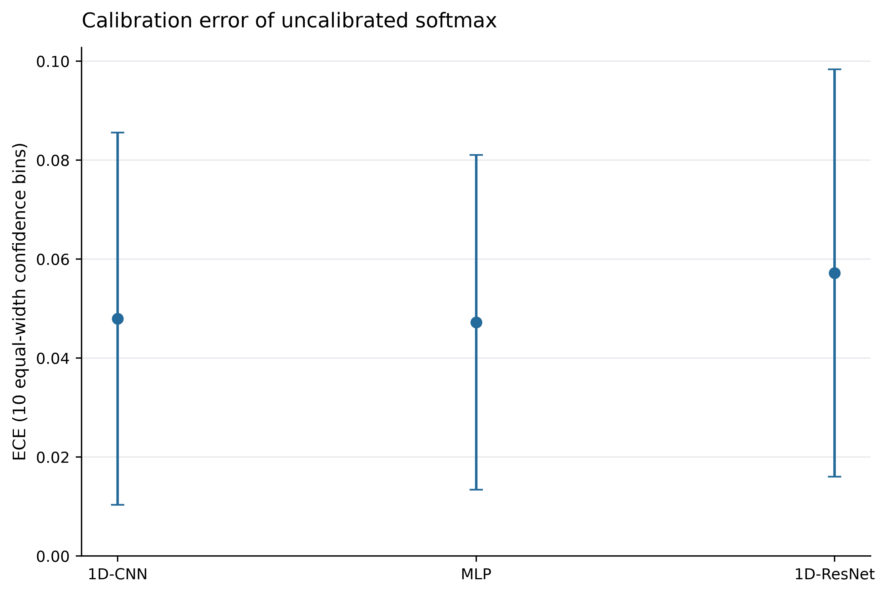
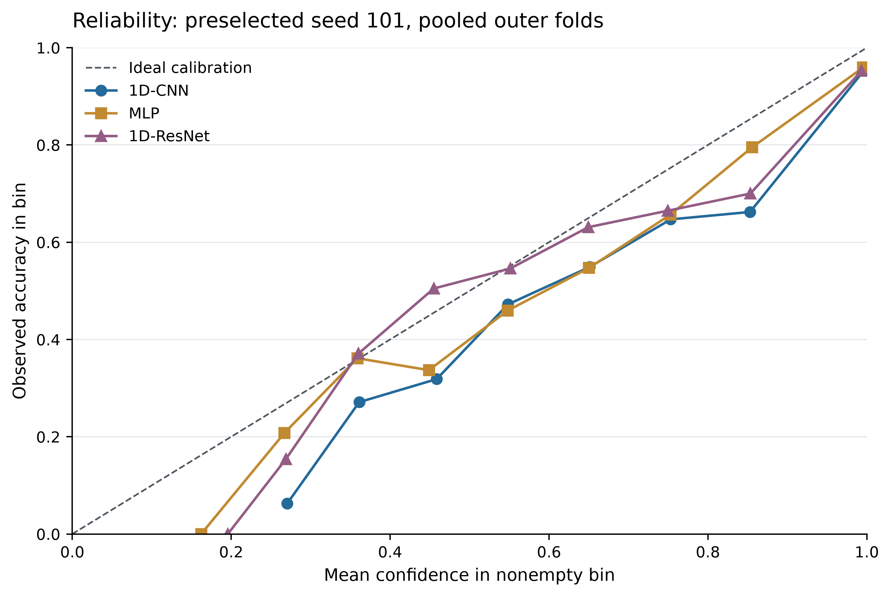

# 拉曼塑料识别：追加12类开发研究

本报告全部计划任务已完成，数值来自保存的外折预测与概率，并经重新计算核对。

## 两阶段证据关系

第一阶段固定六张测试图、15类任务已经完成。其结果用于发现跨采集图识别的困难，不能再用这六张图挑选追加研究模型。第二阶段严格排除这些原测试图，只在原28张开发图上研究共同12类。两个阶段的类别、评价图和研究目的不同，不能把分数直接相减、排在一张性能榜上，或将第二阶段高分当作原15类难点已经解决。

作为历史背景，第一阶段SVM测试准确率72.53%、15类宏平均F1 0.5873；增强CNN三种子平均准确率70.50%、宏平均F1 0.5725（种子标准差0.0181）。这支持‘CNN尚未稳定胜出’，而非深度模型必优。该处仅读取历史汇总表，没有新增原测试预测。

## 数据、划分与预设方法

开发总体26,720条谱，按‘类别在至少3张开发图出现’规则，排除polycarbonate（开发图覆盖2张，360条）、polyurethane（开发图覆盖1张，269条）、silicone（开发图覆盖1张，550条），保留25,541条、12类（含blank）。排除是为了各外折均有真值支持，明确缩小了任务范围；并未验证被排除三类的新模型表现。

三外折按map互斥，外评价并集覆盖共同类开发谱一次。每个外训练集合再划分内训练与5张内验证图，全部角色均覆盖12类。神经网络仅按内验证宏平均F1选择最佳epoch，SVM仅按内验证选择C，随后直接评价外折；不对全外训练集重拟合，不用外评价选模型、轮次、种子或预处理。

预设75次神经拟合与9组基线。架构比较CNN、MLP和ResNet，各折种子101/202/303；另做增强、损失和嵌套图学习曲线。预处理4变体只用seed101，全部关闭增强，与同折关闭增强的默认CNN匹配，避免L2尺度与固定绝对增强噪声强度混杂。

统计层级：每条件每外折先对预定种子平均，再计算3折均值及折间样本标准差（ddof=1）。不把3折×3种子视为9个独立测试样本；折训练集合重叠，因此折间标准差只是此协议下的描述性变化，不是独立标本置信区间。逐图与逐类结果用于诊断，不据此继续调参。

| 外折 | 名义图水平 | 实际训练图 | 实际训练像素 | 实际图比例 |
| --- | --- | --- | --- | --- |
| 1 | maps60 | 8 | 6992 | 0.6153846153846154 |
| 1 | maps80 | 11 | 8400 | 0.8461538461538461 |
| 1 | maps100 | 13 | 10859 | 1.0 |
| 2 | maps60 | 9 | 7844 | 0.6428571428571429 |
| 2 | maps80 | 12 | 9282 | 0.8571428571428571 |
| 2 | maps100 | 14 | 11410 | 1.0 |
| 3 | maps60 | 9 | 9961 | 0.6428571428571429 |
| 3 | maps80 | 12 | 11619 | 0.8571428571428571 |
| 3 | maps100 | 14 | 13458 | 1.0 |

## 架构、传统基线与校准

| 条件 | 像素准确率 | 12类宏F1 | 图等权宏F1 |
| --- | --- | --- | --- |
| architecture:cnn | 0.9230 ± 0.0347 | 0.8687 ± 0.0629 | 0.8560 ± 0.0627 |
| architecture:mlp | 0.9148 ± 0.0402 | 0.8490 ± 0.0813 | 0.8375 ± 0.0898 |
| architecture:resnet | 0.9129 ± 0.0409 | 0.8560 ± 0.0644 | 0.8482 ± 0.0603 |
| baseline:cosine_centroid | 0.7990 ± 0.0251 | 0.6746 ± 0.0832 | 0.6690 ± 0.1091 |
| baseline:pca64_linear_svm | 0.9303 ± 0.0368 | 0.8742 ± 0.0721 | 0.8635 ± 0.0802 |
| baseline:random_forest_300 | 0.8985 ± 0.0614 | 0.8310 ± 0.1041 | 0.8234 ± 0.1058 |

在这个预设协议中，baseline:pca64_linear_svm的3折平均宏F1最高，为0.8742 ± 0.0721。这是描述性比较；未进行显著性检验，不证明在未知物理标本、仪器或被排除类别上普遍占优。

| 条件 | ECE，10箱 | NLL | 多类Brier |
| --- | --- | --- | --- |
| architecture:cnn | 0.0480 ± 0.0376 | 0.6191 ± 0.3917 | 0.1304 ± 0.0634 |
| architecture:mlp | 0.0472 ± 0.0338 | 0.5365 ± 0.3174 | 0.1390 ± 0.0701 |
| architecture:resnet | 0.0572 ± 0.0412 | 0.6522 ± 0.3845 | 0.1482 ± 0.0742 |

ECE、NLL及Brier均越低越好；ECE依赖分箱，Brier按类别求和后再对像素平均，未除类别数。这里只报告未做后验校准的softmax。传统基线没有保存概率，校准表留空。可靠性图预先固定seed101，拼接互斥外折预测、按像素加权；它与主表的折优先平均是不同展示口径，不将汇集图误当作9个独立重复。

## 配对消融与学习曲线

下表是变体减参照的差值，数值使用F1的0–1单位；图中换算为百分点。增强/损失以同折同seed的核心CNN为参照。预处理以同折seed101、关闭增强的默认CNN为参照，只支持单训练种子下3折的匹配结果。

| 变体 | 宏F1配对差值 | 准确率配对差值 |
| --- | --- | --- |
| noaug:cnn | -0.0035 ± 0.0031 | -0.0021 ± 0.0016 |
| preprocessing:l2 | -0.0018 ± 0.0277 | 0.0034 ± 0.0199 |
| preprocessing:no_baseline | 0.0023 ± 0.0340 | 0.0075 ± 0.0228 |
| preprocessing:no_sg | 0.0037 ± 0.0046 | 0.0034 ± 0.0051 |
| preprocessing:quadratic | -0.0026 ± 0.0238 | 0.0030 ± 0.0159 |
| unweighted:cnn | -0.0004 ± 0.0055 | -0.0023 ± 0.0020 |

训练图学习曲线使用内训练图的嵌套子集，各水平覆盖12类；真实图比例受向上取整影响，像素数与图比例也不相同。100%复用核心CNN，不算额外拟合。图中保留各折真实横坐标，不把名义60%称为保留60%像素。

## 扰动、逐图与逐类诊断

加噪实验在已预处理的SNV空间加入零均值高斯扰动，标准差为0.02/0.05/0.10/0.20，加噪后不再SNV；同折同水平使用相同噪声实现。它测量模拟扰动敏感性，并非测量真实仪器SNR、外部数据集性能或噪声因果。各水平仅一次噪声实现，不能据此证明某种真实采集噪声导致第一阶段错误。

核心CNN的较弱类别（事先固定汇报CNN，不据此挑模型）：PVC：F1 0.5107 ± 0.4332；PA：F1 0.6294 ± 0.2133；PP：F1 0.8535 ± 0.1127。完整类别表保留全部类别，以上仅为误差定位。

核心CNN的较弱外评价图（每图先平均3种子）：Map_PVC_1：准确率49.06%；Map_PVC_ABS_PEs：准确率76.24%；Map_Nylon_POM：准确率76.35%。这里的图值属于各自外折，不能把单图差异直接归因于唯一噪声或标签问题。

## 证据边界与结论

34张公开采集图并不等同于34个可追踪的独立物理标本，跨图可能共享原始材料；像素之间相关，不能以25,541条谱数构造极窄的独立样本区间。任务保留原库PET与PEs标签层级，含blank但不等于未知类拒识，也没有混合物定量、颗粒计数或二维分割结果。原CSV标签与元数据计数的冲突仍保留在数据审计中。

第二阶段已完成预设规模的模型、消融、学习曲线与扰动校准评价。其作用是在共同12类开发图上检验方法选择的稳定性和误差结构；第一阶段15类六图测试的原始结论保持不变。后续若要宣称独立材料或跨仪器应用，需要采集可追踪的新样品、明确物理标本分组并锁定外部评价集。

## 可复现与图表说明

输入来自冻结协议、训练元数据、外折预测/概率及基线结果；本脚本只读取结果，不加载权重训练，也不读取原测试图作新预测。summary目录保留run级、折级、跨折汇总、配对差值、完整逐图逐类指标及可靠性分箱计数。PNG以高分辨率导出，同时提供可编辑文本PDF。每图一个科学坐标轴，多面板对齐不适用。

计划SHA256：`864cf5c8efe54d8ee885b9cc848f9f9ac7cd1eb2c30b9bdb27970e5bc1a18004`；划分SHA256：`f5f818e287bc0033afcc47f2729c27ba8194474be2430d3b9612d94b420259a6`；数据SHA256：`f760aea38fc98a71629c18fd4157dd023b4f0782f7f5cc9602d31f642a109851`。

图形自动审计状态：自动审计通过，仍需目视检查警告。详见summary/figure_qa.json；自动几何检查不能替代最终显示尺寸的目视检查。

数据署名：Smith等RaMPI，Borealis，[DOI 10.5683/SP3/8UQQQN](https://doi.org/10.5683/SP3/8UQQQN)，CC BY 4.0；相关论文Hogan等，Scientific Data 13,765(2026)，[DOI 10.1038/s41597-026-07103-8](https://doi.org/10.1038/s41597-026-07103-8)。本作业进行了数据校验、插值、逐谱预处理、共同类过滤和按图建模评价。姓名、学号与实际贡献在最终汇报中按本人实做填写。

### architecture_comparison

模型比较。点及误差棒为3外折均值±折间样本标准差，灰色短线为各折值。神经网络每折先平均3种子；传统基线每折1次。误差棒不是置信区间，3折也不是独立物理标本。源数据：condition_fold_means.csv、condition_summary.csv。

### augmentation_loss_paired

配对消融，横轴为变体减参照的宏平均F1差值，单位为百分点。参照：同折同训练种子的默认增强、加权损失CNN；每折先平均3个配对种子的差值。点/棒为3折均值±折间样本标准差，灰线为每折差值；不作显著性或单一机制因果声明。源数据：paired_ablation_runs.csv、paired_ablation_fold_means.csv、paired_ablation_summary.csv。

### preprocessing_paired

配对消融，横轴为变体减参照的宏平均F1差值，单位为百分点。参照：同折同seed101、关闭增强的默认预处理CNN；所有变体关闭增强，排除固定绝对增强噪声与L2尺度的混杂。每折仅1训练种子。点/棒为3折均值±折间样本标准差，灰线为每折差值；不作显著性或单一机制因果声明。源数据：paired_ablation_runs.csv、paired_ablation_fold_means.csv、paired_ablation_summary.csv。

### learning_curve_maps

嵌套按图学习曲线。每个点为同一外折中3种子均值，三条线分别为外折，不将其当作独立物理样品。只改变内训练图子集，内验证/外评价图固定；100%复用核心CNN。横轴为真实图比例或真实像素数，名义60%/80%不等于像素比例。各折曲线没有折间误差棒，因为没有把不同横坐标折叠到同一个点。源数据：fold_train_sizes.csv、learning_curve_fold_means.csv。

### learning_curve_pixels

嵌套按图学习曲线。每个点为同一外折中3种子均值，三条线分别为外折，不将其当作独立物理样品。只改变内训练图子集，内验证/外评价图固定；100%复用核心CNN。横轴为真实图比例或真实像素数，名义60%/80%不等于像素比例。各折曲线没有折间误差棒，因为没有把不同横坐标折叠到同一个点。源数据：fold_train_sizes.csv、learning_curve_fold_means.csv。

### noise_robustness

模拟高斯扰动敏感性。0为原外折输入；其余标准差在既有SNV输入空间加噪且不再次SNV。同折、同噪声水平的模型与种子使用同一噪声实现。每折先平均3种子，再报告3折均值±折间样本标准差。每水平仅1噪声实现，不代表真实仪器信噪比、外部验证或真实噪声机制。源数据：noise_run_metrics.csv、noise_fold_means.csv、noise_summary.csv。

### calibration_ece

未进行后验校准的softmax置信度误差。ECE使用10个等宽置信度区间，每折先平均3种子，再报告3折均值±折间样本标准差；越低表示该分箱定义下平均置信度与正确率越接近。NLL和多类Brier另列校准表，Brier按类别求和后对像素平均，未再除类别数。传统基线无概率输出，因此不编造其校准指标。源数据：calibration_summary.csv。

### calibration_reliability

可靠性图固定展示预先指定的seed101，汇集3个互斥外折的逐像素预测；每个像素恰好出现一次，点按像素加权，空箱保留在CSV而不画为零。该图仅作诊断，不含折间误差棒，不替代主表的折优先统计，不用于挑选种子或选择后验温度。源数据：reliability_seed101_bins.csv，内含每箱数量。
