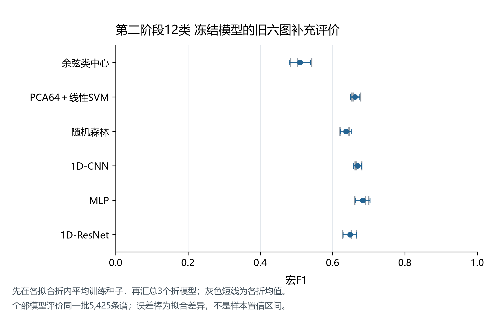

# 第二阶段冻结模型在既有六张测试图上的补充评价

本报告根据2026年11月16日已经完成并通过独立核查的预测编写。它回答的是：第二阶段原来保存的模型，在第一阶段已经查看过的六张测试采集图上表现如何。**本次没有训练新模型，没有全28张开发图重拟合，没有选择最好外折或种子，也没有做投票或概率集成。**

## 主要发现

固定36个既有拟合模型均评价相同5,425条、12类光谱。MLP的平均宏F1为 **0.6837 ± 0.0201**，像素准确率 **79.21% ± 1.62个百分点**，在此次六方法描述性比较中均值最高；CNN和PCA64＋线性SVM的宏F1分别为0.6691 ± 0.0102和0.6620 ± 0.0134。这里的标准差来自同一holdout上的三组拟合模型差异，不是独立测试样本的置信区间，也不能据此宣布MLP普遍或显著更好。[1](condition_summary.csv)

过滤后三分之一的图只剩背景：`Map_PC_2`的612条、`Map_Silicone`的465条均为blank。真正保留塑料真值的只有4张图，而且每个保留塑料类别都仅由其中1张图提供真值。MLP对2,470条真正塑料谱的平均准确率为57.34%，明显低于含背景总体的79.21%；因此需要同时看材料支持和分层结果，不能将总体分数当成所有塑料类别的可靠鉴定能力。[2](map_support.csv) [3](scope_summary.csv)

## 评价对象来自原开发CV 而非新训练的最终模型

冻结清单包括27个神经模型：CNN、MLP、ResNet各3个原外折、每折3个训练种子101、202、303；另有9个传统模型：余弦类中心、PCA64＋线性SVM、300树随机森林，各原外折1个。共36个已有权重/传统模型，全部进入评价。[4](../../protocol/stage2_holdout_plan.json)

原外折编号在这里标识**模型如何训练出来**，并不是将这6张测试图重新分成3个评价折。每个模型均独立预测全部相同的5,425条光谱；没有把36套预测拼成OOF（开发样本的外折预测），也没有将它们组合成一个集成模型。神经模型仍是原内训练图拟合、内验证锁定最佳epoch的权重；并未用全部28张开发图重拟合。

这个补测是在原六图测试结果已经被查看之后提出的。训练图和测试图继续隔离、此次清单也在推理前冻结，这些措施保留了可追踪性；它们不能让已查看的数据重新变成未见过的盲测，更不能将这些公开采集图称为本项目新采集的外部验证。

## 从6399条15类过滤至5425条12类

输入来自原主NPZ的1024点默认处理光谱。程序逐值核对原25,541条开发数据的`original_index`映射，确认主NPZ相同行与`extension_study/data/study_data.npz`的`X_default`完全一致，然后沿用原开发协议的12类标签过滤测试像素。

原测试共6,399条，排除原共同类任务没有建模的PC 578条、PU 78条、Sil 318条，合计974条，保留5,425条。保留像素含blank 2,955条、塑料2,470条。排除规则不由本次预测成绩决定；代价是PC、PU、Sil完全不在这次评价范围内。不能以过滤后的分数说明这三类的问题已解决。

| 原测试图 | 原像素 | 保留像素 | 排除像素 | 保留blank | 保留塑料 | 保留真值类别 |
| --- | ---: | ---: | ---: | ---: | ---: | --- |
| Map_Env_PP_PTFE | 2280 | 2280 | 0 | 854 | 1426 | blank、PP、PTFE |
| Map_Nylon_PEs_PS | 750 | 750 | 0 | 242 | 508 | blank、PA、PEs、PS |
| Map_PC_2 | 1190 | 612 | 578 | 612 | 0 | blank |
| Map_PMMA_PET_PE_ABS | 676 | 676 | 0 | 314 | 362 | ABS、blank、PMMA、PE、PET |
| Map_PVC_PU_POM | 720 | 642 | 78 | 468 | 174 | blank、POM、PVC |
| Map_Silicone | 783 | 465 | 318 | 465 | 0 | blank |

表中每一行来源于[逐图支持表](map_support.csv)。`Map_PC_2`与`Map_Silicone`仍保留图名，但对应的PC/Sil像素已经排除，不能把它们的高准确率写成PC或Sil的识别率。

## 六类方法的完整结果

| 方法 | 既有拟合数 | 像素准确率 % | 12类宏F1 | 图平均准确率 % | 图等权宏F1 |
| --- | ---: | ---: | ---: | ---: | ---: |
| 余弦类中心 | 3 | 68.70 ± 1.67 | 0.5096 ± 0.0298 | 82.24 ± 0.83 | 0.5666 ± 0.0260 |
| PCA64＋线性SVM | 3 | 77.82 ± 0.66 | 0.6620 ± 0.0134 | 87.85 ± 0.51 | 0.7127 ± 0.0077 |
| 随机森林300树 | 3 | 74.87 ± 1.79 | 0.6369 ± 0.0144 | 85.83 ± 0.99 | 0.6738 ± 0.0039 |
| 增强1D-CNN | 9 | 77.93 ± 1.44 | 0.6691 ± 0.0102 | 87.63 ± 0.60 | 0.7070 ± 0.0071 |
| 增强MLP | 9 | 79.21 ± 1.62 | 0.6837 ± 0.0201 | 88.15 ± 0.93 | 0.7177 ± 0.0148 |
| 增强1D-ResNet | 9 | 77.00 ± 1.81 | 0.6481 ± 0.0190 | 87.12 ± 0.87 | 0.6841 ± 0.0150 |

来源：[condition_summary.csv](condition_summary.csv)。所有±为样本标准差（ddof=1）。准确率列以百分数显示，±数值的单位为百分点；F1使用0至1数值。神经模型先在每个原拟合外折内平均3个种子，再对3组拟合求均值与SD；传统方法每组只有1次拟合，再对3组求均值与SD。这里没有新增9套独立测试数据。

图平均准确率是6张图各自准确率的算术平均；图等权宏F1给每条谱分配“1÷所在图保留像素数”的权重，再计算加权后的宏F1，**不是各图F1简单平均**。两张blank-only图在图平均准确率中各占六分之一，因此必须结合下节的4图结果解释。平衡准确率及未舍入值也保留于CSV。

图中蓝点和误差棒为上述均值与拟合差异SD，灰色短线为各原拟合外折的种子平均值。原图、表和冻结预测一同保留；该图不增加一次新模型推理。

## 区分含背景四图与真正塑料像素

四个scope是预先固定的诊断范围，彼此存在重叠，不能将它们的样本数相加：

- `all_eligible_pixels_6_maps`：全部5,425条，含背景，12类宏F1。
- `plastic_supported_maps_4_maps`：4张仍有塑料真值的图，共4,348条，**仍包括这4图的背景**，12类宏F1。
- `plastic_pixels_only_4_maps`：只取真值非blank的2,470条，宏F1平均11个有真值塑料类；预测为blank仍计为错误。
- `blank_only_maps_2_maps`：两张图合计1,077条，真值全部是blank，只诊断背景识别。

| 方法 | 4塑料支持图准确率 % | 4图12类宏F1 | 仅塑料像素准确率 % | 仅塑料11类宏F1 | 2图仅blank准确率 % |
| --- | ---: | ---: | ---: | ---: | ---: |
| 余弦类中心 | 61.22 ± 2.08 | 0.5100 ± 0.0302 | 33.91 ± 3.58 | 0.4788 ± 0.0335 | 98.89 ± 0.00 |
| PCA64＋线性SVM | 72.60 ± 0.82 | 0.6628 ± 0.0131 | 53.67 ± 1.32 | 0.6412 ± 0.0148 | 98.89 ± 0.00 |
| 随机森林300树 | 68.86 ± 2.18 | 0.6367 ± 0.0143 | 46.44 ± 3.67 | 0.6095 ± 0.0146 | 99.13 ± 0.19 |
| 增强1D-CNN | 72.71 ± 1.85 | 0.6692 ± 0.0104 | 54.10 ± 3.42 | 0.6490 ± 0.0096 | 99.01 ± 0.24 |
| 增强MLP | 74.32 ± 2.02 | 0.6843 ± 0.0199 | 57.34 ± 3.24 | 0.6674 ± 0.0217 | 98.92 ± 0.09 |
| 增强1D-ResNet | 71.58 ± 2.28 | 0.6481 ± 0.0190 | 52.46 ± 3.81 | 0.6275 ± 0.0209 | 98.90 ± 0.18 |

来源：[scope_summary.csv](scope_summary.csv)；±的含义与主表一致。仅塑料11类宏F1与含背景12类宏F1的平均类别和像素总体都不同，不应直接相减解释为性能变化。每种塑料只有一张真值图，无法由大量相邻像素获得独立标本层面的重复验证。

## 概率指标的覆盖范围

27个神经模型保存原始softmax概率，3个RF保存原始`predict_proba`，共30份概率矩阵；均未利用本holdout拟合校准器或阈值。余弦类中心及线性SVM共6个拟合没有校准概率，本次不将decision score伪造为概率，它们仍完整参加分类指标比较。各run的metadata明确记录概率是否可用，class/per-map/prediction/probability文件都能追溯到源权重与配置的SHA256。

## 与其他结果的关系及局限

原12类开发CV分数继续保留于[original_cv_reference.csv](original_cv_reference.csv)，原始产物仍在`extension_study/results`。开发CV评价的是各自互斥外折的开发像素，而本补测反复评价同一批旧六图像素；两者既不能合并成一份OOF，也不应取平均当成“最终分数”。本次拟合差异SD与原CV的折间SD也不具有同一解释。

第一阶段包括新增RF/MLP/ResNet后的比较使用15类、6,399条；本报告使用12类、5,425条，并复用不同训练规模、不同训练种子的第二阶段权重，不能将两表数值直接相减宣称模型改善。不同模型在不同口径下的排序变化，是需要继续调查的观察，不证明某个训练组件造成了变化。

本补测的价值是暴露已冻结方法在另外一组既有采集图上的适用边界。图间可能共享材料来源，PC/PU/Sil没有被检验，每塑料类只有1张真值图，测试结果又已被查看；若要确认对新材料或新仪器的应用能力，需要可追踪的新标本、独立数据采集，以及模型/处理方案锁定后的新评价。

## 审计与文件覆盖范围

独立审计用另一套NumPy混淆矩阵实现复核全部36组预测、30份概率、逐类/逐图及四scope指标和层次汇总，第二阶段最大指标误差为 **4.44×10⁻¹⁶**。这表示两套指标实现一致，不表示模型预测错误接近零；审计没有重新训练或执行模型前向。[5](../../qa/supplement_results_audit.json)

原始推理回执[execution.json](execution.json)记录36个模型的实际推理和当时`output_files`列出的文件SHA。本报告在推理与审计完成后新写，**没有加入或修改该历史回执的`output_files`，不声称被该回执原始哈希清单覆盖**。新增报告与其他交付说明的哈希，由后续交付清单另行记录。输入权重、源代码、原首轮及原扩展结果均保持只读。

复核命令与完整包要求见[补充实验README](../../README.md)。数据署名、DOI和CC BY 4.0及修改声明沿用[数据来源与研究边界](../../../数据来源与研究边界.md)，本次不改变数据许可或原标签。
