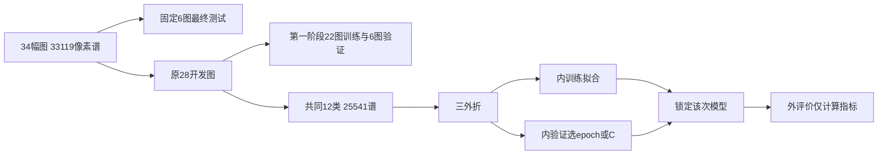

# 代码导读与评价逻辑

研究问题是：给定一条拉曼光谱，能否识别其塑料类别或背景，并迁移到另一幅采集图？输入是1024个固定拉曼位移点的强度，输出是类别。项目没有采集新数据，不把相邻像素当成独立物理材料样品，也不从没有二维坐标的CSV猜测分割图。

## 先分清两阶段

第一阶段使用全部34图、15类，固定22图训练、6图验证、6图最终测试。验证缺少PU和Sil两类，因此验证macro-F1平均13类，测试平均15类。模型先锁定，再统一计算测试结果。

第二阶段使用原28开发图中覆盖足够的12个共同类别，做三外折研究。每折先分内训练和内验证，外评价图保持隔离。这里比较更多模型和消融，但不再对原6图反复选模型。两阶段任务不同，分数不能直接相减后宣称提升。

## 每部分代码完成什么

| 文件 | 作用与防止的问题 |
| --- | --- |
| src/prepare_data.py | 下载34份CSV、核MD5、检查标签与重复谱、逐谱预处理；防止下载不完整或跨谱统计泄漏 |
| src/make_split.py | 固定图级划分及类别覆盖，保存协议；防止同图相邻像素混到训练和测试 |
| src/train_baselines.py | 类中心及PCA＋SVM，只用验证选C |
| src/models.py、train_cnn.py | 一维CNN、增强、训练与早停；只保存验证最佳权重 |
| src/evaluate.py | 模型锁定后统一评价原6图，拒绝把smoke检查当正式模型 |
| extension_study/src/split_study.py | 冻结共同类别、嵌套3折和训练图数量子集 |
| extension_study/src/prepare_study_data.py | 仅开发图生成5套逐谱表示；不读取原6图原始强度 |
| extension_study/src/build_plan.py | 保存75个神经训练配置及基线参数，避免看分数后静默改配置 |
| extension_study/src/study_models.py | 同一输入接口实现CNN、MLP和1D-ResNet |
| extension_study/src/run_study.py | 内训练拟合、内验证早停、外折评价，保留逐谱预测、概率和checkpoint |
| extension_study/src/audit_study_results.py | 不调用训练指标helper，手工构造混淆矩阵独立核对全部结果 |
| extension_study/src/summarize_study.py | 先折内平均种子、再统计三折，生成配对消融、学习曲线、噪声与校准诊断 |

## 六类模型为什么都要做

余弦类中心用每类的平均谱作参照，提供容易解释的低复杂度基线。PCA＋线性SVM先压缩到64个训练集主成分，再学习分类边界。随机森林提供树模型对照，减少只比较两种神经网络的局限。

MLP直接联合使用全部1024个位置；CNN用局部一维卷积，并保留16个位置区段后分类；1D-ResNet使用残差连接，保留8个位置区段后分类。这些设计是需要实验检验的不同归纳偏置，不意味着越深或参数越多就必然更准。

12类版本的参数数为：CNN 320,076，MLP 660,748，1D-ResNet 1,227,372。第一阶段15类CNN为320,463。三者都从随机初始化训练，没有借用预训练模型。

## 最值得理解的三个公式

逐谱SNV为 `z=(x-mean(x))/std(x)`，均值和标准差只来自该条谱，不利用其他图或类别。SNV同时中心化与缩放；L2只控制向量范数，保留相对直流偏置。两者都不保留原始绝对强度，这组对照主要比较中心化及尺度定义的影响。

一类的F1为 `2TP/(2TP+FP+FN)`。macro-F1对评价集合有真值的每类等权平均，更能暴露少数类别失败；准确率则对每个像素等权。项目同时报告图平均准确率和图等权macro-F1，检查大图或背景主导的影响。

类别加权交叉熵使用 `w_c=N/(K*n_c)`，其中N和n_c仅来自本次内训练。该权重让少数类在训练目标里更受关注，但是否改善外图识别仍由预先安排的对照回答。

## 怎样解释进一步分析

- 结构对照：相同划分与训练规则下比较MLP、CNN、ResNet，不能只展示最高种子。
- 配对消融：同折同种子比较增强或加权损失；预处理用关闭增强的seed101匹配比较。
- 学习曲线：按图减少内训练规模，各水平全类覆盖且严格嵌套；像素数不是独立样品数。
- 噪声测试：在既有SNV输入上加固定高斯扰动，评估模拟敏感性，不把它叫成真实仪器验证。
- 概率校准：ECE、NLL和Brier描述softmax概率质量；置信度高不等于一定正确，诊断后没有利用外折结果校准温度。

三个种子测量优化随机性，三个外折描述图的变化，二者不是同一种重复。主表先平均每折三个种子，再报告三折均值±样本标准差；误差棒不是置信区间。

## 汇报时应坚持的事实

原CSV塑料/背景计数与论文元表有3处冲突，项目如实保留，未为匹配论文或提高模型分数修改标签。图之间可能共享材料来源，缺少粒子/物理样品ID，所以跨图评价不能宣称已验证独立新产品、浓度定量或未知仪器。

如果更复杂的网络没有稳定胜过传统基线，这本身就是结果。应解释它在什么评价口径和哪些图上失败，再提出需要新独立数据验证的改进方向，不能回头挑原6图上的最高结果包装成泛化突破。
